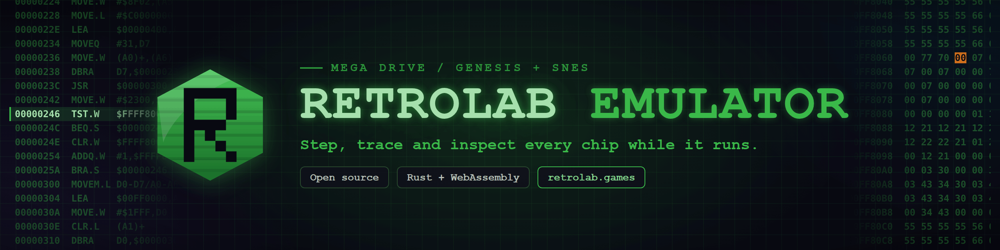

> **Support RetroLab.** If you like this project, you can support it with a
> [RetroLab Pro](https://retrolab.games/pricing) subscription, and by
> following RetroLab on [YouTube](https://www.youtube.com/@RetroLabGames)
> and [Instagram](https://www.instagram.com/retrolabgames/).

A Mega Drive / Genesis and Super Nintendo emulator written in Rust, built
for debugging: every core can be stepped, traced, and inspected while it
runs, through a debugger with breakpoints, watchpoints, disassembly, memory
and video views. It compiles to WebAssembly, and it is the emulator the
[RetroLab platform](https://retrolab.games) runs.

- `cores/sg1`: the Mega Drive / Genesis (68000, Z80, VDP, YM2612, SN76489,
  and the Virtua Racing SVP).
- `cores/snes1`: the Super Nintendo (65C816, SPC700, PPU, S-DSP, and the
  SA-1, Super FX, Cx4, DSP-1, S-DD1 and SPC7110 cartridge chips).
- `cpus/`, `retro-core/`: the CPUs and the traits every core implements.
- `web/`: a debugger that runs in the browser; `debugger-core/` holds the
  TypeScript it shares with RetroLab's.

## Where to play

The emulator runs in the browser in two places.

**Its own page**, at <https://dgdiniz.github.io/retrolab-emulator/>, is the
debugger in this repository: open or drop a Mega Drive or SNES ROM, and it
runs in the page. The ROM is read in your browser and never leaves your
computer.

**[RetroLab](https://retrolab.games)** is the platform this emulator was made
for. It runs the same emulator with extra features around it:

- a game library that syncs across your devices, or stays on your computer
  with no account;
- a code editor with an assembler, to write games for the consoles and run
  them in the same tab, and a studio for sprites, palettes and tilemaps;
- graphics capture: the sprites, layers and animations the console is
  drawing, taken from video memory with their palettes;
- lessons, articles and snippets to learn, teach and share;
- two-player online play from a link, with input prediction and rollback;
- screenshots, video and GIF recording, and links that open a game, a
  savestate, a project or a debug session;
- many more systems, from the Atari 2600 to the Playstation 2, and DOS games.

RetroLab is free to use, and a
[Pro subscription](https://retrolab.games/pricing) raises its limits and
supports the project.

## Build

You need Rust (stable) and, for the WebAssembly builds, wasm-pack
(`cargo install wasm-pack`) and the `wasm32-unknown-unknown` target
(`rustup target add wasm32-unknown-unknown`).

```sh
cargo build --workspace --release
./build-wasm.sh    # both cores to WebAssembly, into cores/*/wasm/pkg/ and web/public/pkg/
```

## Test

```sh
cargo test --workspace
./check.sh    # every check a change should pass: formatting, lints, the tests,
              # the WebAssembly tests, the benchmarks once, the licenses, and
              # the tests and types of debugger-core/ and web/
```

The CPU tests that run against published test vectors (Tom Harte's 68000
vectors and the SingleStepTests of the Z80, 65C816 and SPC700) are ignored
until the vectors are downloaded. From this folder, in a POSIX shell:

```sh
# fetch <repository> <commit> <folder> [<path>]: one commit, only <path> if given
fetch() {
  git init -q "$3" && git -C "$3" remote add origin "https://github.com/SingleStepTests/$1"
  [ -z "$4" ] || git -C "$3" sparse-checkout set "$4"
  git -C "$3" fetch -q --depth 1 --filter=blob:none origin "$2" && git -C "$3" checkout -q FETCH_HEAD
}
fetch ProcessorTests bb11756436da8fd16cce86aef63dc6725f48836f tests/tom_harte_repo 680x0/68000/v1
fetch z80 cbfec3caf2e971dc91f21c617fef712f9e4285ca tests/singlesteptests/z80
fetch 65816 307c63f5673c8c6b861c52f71ddb89212a227480 tests/singlesteptests/65816
fetch spc700 67d15f492b2740964abd4efd1229e0ec9c342228 tests/singlesteptests/spc700
```

Then:

```sh
cargo test --release -p sg1-core --test tom_harte_runner -- --ignored
cargo test --release -p sg1-core --test singlestep_runner -- --ignored
cargo test --release -p wdc65816 --test singlestep_runner singlestep_sweep_summary -- --ignored --nocapture
cargo test --release -p spc700 --test singlestep_runner singlestep_sweep_summary -- --ignored --nocapture
```

## The web debugger

It is published at <https://dgdiniz.github.io/retrolab-emulator/>. To build
it and serve it from your own computer:

```sh
./build-wasm.sh
cd web
npm install
npm run build
npm run serve    # http://localhost:8000/
```

## The command-line tools

`sg1-cli` (Mega Drive / Genesis) and `snes1-cli` (SNES) help debug games
and develop new ones for both consoles, by hand or through an AI agent.
They are AI-friendly: they run without a window, take their input as
arguments, can press the controller at chosen frames
(`--press-at "180:start;186:;240:a"`), and answer in plain text or in files
an agent can open. They take screenshots, dump memory and video memory,
capture audio, save and load savestates, and write execution traces in
MAME's and bsnes-plus's text formats, which they also compare line by line
against a log those emulators wrote. `sg1-cli` also finds which
instruction writes a RAM address or reads a table in ROM.

```sh
cargo run --release -p sg1-cli -- --help
cargo run --release -p sg1-cli -- screenshot game.bin --frames 300 -o shot.png
cargo run --release -p sg1-cli -- compare-trace game.bin mame-trace.log --skip-timing
cargo run --release -p snes1-cli -- trace game.sfc --frames 1 -o trace.log
```

Every command lists its options with `--help`, which is where an agent
starts.

## License

ISC, in [`LICENSE`](LICENSE). Some parts of the emulator are based on
other projects; their notices are at the end of the same file.

This project is not affiliated with or endorsed by Sega or Nintendo.
